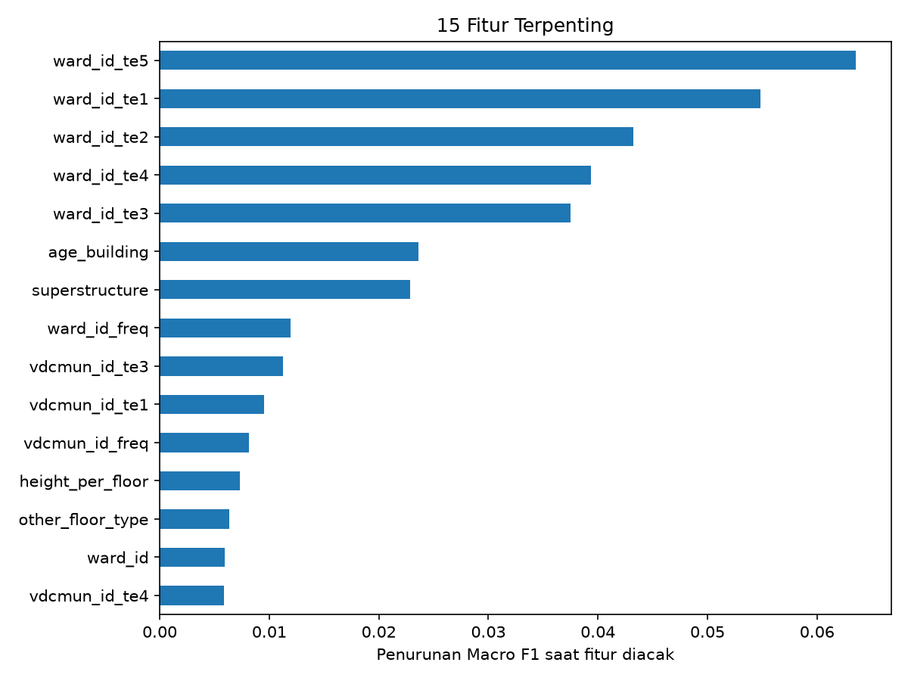

# Klasifikasi Tingkat Kerusakan Bangunan Pasca-Gempa

Proyek Kaggle Competition untuk memprediksi **tingkat kerusakan bangunan** (`damage_grade`, Grade 1 sampai Grade 5) akibat gempa, berdasarkan karakteristik struktur bangunan dan lokasinya.

- **Tipe masalah:** klasifikasi multi-kelas (5 kelas)
- **Metrik evaluasi:** Macro F1-Score
- **Skor leaderboard Kaggle:** **0.55144** (naik dari 0.5099 pada submission awal)

## Dataset

| File | Keterangan |
|---|---|
| `train.csv` | Data latih berlabel (± 533 ribu bangunan) |
| `test.csv` | Data uji tanpa label (228.629 bangunan) |
| `sample_submission.csv` | Contoh format pengumpulan |
| `metadata.csv` | Deskripsi kolom |

Fitur mencakup kondisi bangunan (jumlah lantai, umur, luas, tinggi, jenis fondasi, atap, lantai dasar, struktur utama) dan kode wilayah (`district_id`, `vdcmun_id`, `ward_id`). Data tidak disertakan di repositori ini; unduh dari halaman kompetisi Kaggle dan letakkan di folder `data/`.


## Pendekatan

### 1. Baseline: strategi multi-kelas One-vs-All dan One-vs-One
Logistic Regression dibungkus dengan `OneVsRestClassifier` (5 classifier biner) dan `OneVsOneClassifier` (10 classifier biner), lalu dibandingkan. Preprocessing: imputasi, standardisasi fitur numerik, dan one-hot encoding fitur kategorik.

### 2. Model final: Gradient Boosting
`HistGradientBoostingClassifier` dengan tambahan berikut:

- **Pembersihan umur bangunan.** Nilai `999` pada `age_building` adalah kode "tidak diketahui", sehingga diubah menjadi NaN dan ditambah fitur penanda `age_unknown`.
- **Fitur turunan.** Luas per lantai, tinggi per lantai, dan rasio ramping (tinggi terhadap akar luas dasar).
- **Target encoding wilayah.** Peluang tiap grade per `ward_id` dan `vdcmun_id`, dihitung secara out-of-fold (5-fold) agar label baris itu sendiri tidak ikut "bocor" ke fiturnya, dengan smoothing ke rata-rata global.
- **Bobot kelas untuk Macro F1.** Probabilitas tiap kelas dikalikan pengali yang dicari untuk memaksimalkan Macro F1 pada data validasi (Grade 1 dan 2 yang jarang jadi lebih diperhatikan).

## Hasil

Validasi hold-out 20% (stratified):

| Model | Macro F1 | Accuracy |
|---|---|---|
| Logistic Regression, One-vs-All | 0.5044 | 0.5417 |
| Logistic Regression, One-vs-One | 0.5075 | 0.5390 |
| Gradient Boosting + fitur lokasi | 0.5397 | 0.5824 |
| Gradient Boosting + fitur lokasi + bobot kelas | **0.5502** | 0.5741 |

Skor leaderboard Kaggle model final: **0.55144**, konsisten dengan hasil validasi.

Detail perbandingan ada di `reports/model_comparison.csv`.

### Fitur terpenting



Fitur lokasi (target encoding `ward_id` dan `vdcmun_id`) mendominasi, disusul jenis struktur utama (`superstructure`) dan umur bangunan. Artinya, lokasi bangunan (dan kemungkinan kedekatannya dengan pusat gempa) menjadi petunjuk terkuat tingkat kerusakan. Ini juga menjelaskan mengapa model linear dengan one-hot encoding kurang optimal: pengaruh wilayah berinteraksi dengan karakteristik bangunan.

### Pembelajaran

- Model linear sulit menangkap interaksi antar fitur (misalnya jenis struktur di wilayah tertentu), sedangkan gradient boosting menangkapnya secara otomatis.
- Untuk Macro F1, menyesuaikan ambang keputusan antar kelas memberi peningkatan sekitar 0.01 tanpa melatih ulang model.
- OvO sedikit lebih baik daripada OvA pada baseline linear, sejalan dengan teori bahwa OvO lebih cocok untuk kelas yang saling tumpang tindih (grade bersebelahan).

## Struktur Repositori

```
.
├── README.md
├── requirements.txt
├── data/
│   ├── metadata.csv
│   ├── train.csv
│   ├── test.csv
│   ├── sample_submission.csv                 
├── notebooks/
│   ├── 01_eda.ipynb         # eksplorasi data
│   ├── 02_modeling.ipynb    # eksperimen model baseline
│   └── 03_submission.ipynb  # menjalankan training dan prediksi
├── scripts/
│   ├── __init__.py
│   ├── preprocess.py            # preprocessing untuk baseline logreg
│   ├── feature_engineering.py   # fitur turunan dan target encoding
│   ├── train.py                 # evaluasi model dan latih model final
│   └── predict.py               # membuat file submission
├── models
│   └── final_model.pkl
├── submissions
│   └── submission.csv
└── reports/
    ├── model_comparison.csv
    └── figures/feature_importance.png
```

## Cara Menjalankan

```bash
# 1. Pasang dependensi
pip install -r requirements.txt

# 2. Letakkan train.csv, test.csv, sample_submission.csv di folder data/

# 3. Latih model (membandingkan semua kandidat, lalu menyimpan model final)
python -m scripts.train

# 4. Buat file submission
python -m scripts.predict
```

Jalankan perintah dari folder root proyek. Hasil akhir tersimpan di `submissions/submission.csv`. Proses training memakan waktu sekitar 10 menit pada CPU biasa.

## Keterbatasan

- Bobot kelas dituning pada satu split validasi, sehingga estimasi skornya sedikit optimistis. Validasi silang akan membuatnya lebih stabil.
- Belum ada tuning hyperparameter mendalam maupun ensemble beberapa model.
- Skor leaderboard publik hanya dihitung dari sebagian data uji dan dapat bergeser pada skor akhir.

## Library

Python, pandas, NumPy, scikit-learn, matplotlib, Jupyter.
